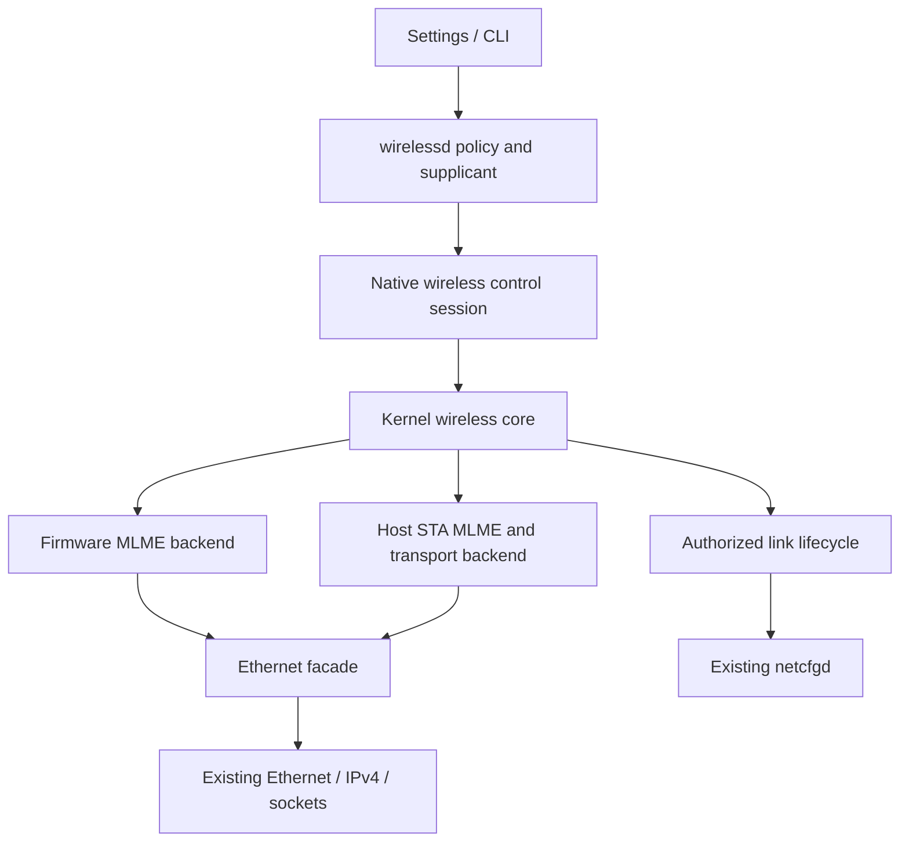

# Native Wi-Fi control and data API

Status: common control API, controlled Ethernet data path and deterministic
mocks implemented, including EAPOL transport, confirmed key installation/deletion
and explicit controlled-port authorization. A pinned upstream WPA2-Personal
supplicant and Native adapter implement the four-way handshake, MIC verification
and GTK unwrap. Software CCMP-128 data encryption/decryption and key-scoped
PN/replay handling, protected EAPOL and atomic GTK rekey are implemented and
tested through an encrypted mock transport.
Host STA MLME is outside this implementation. Physical drivers bind to the
common contract in their board projects; board resources, firmware startup and
device-specific plans belong in those projects' documentation.

## Architecture and scope

Reuse `NetworkDevice`/`EthernetDevice`, the existing link IDs/generations,
Ethernet/IPv4/socket stack and `netcfgd`. The public wireless endpoint describes
connection intent independently of whether association is managed by firmware
or the host. FullMAC devices (for example the Switch's Broadcom radio) and
host-MLME devices (for example coachz's Qualcomm radio) need different internal
backends. Association, WPA key exchange and encryption offloads are separate
capabilities; one cannot be inferred from another.

The kernel owns radio lifecycle, operation identity and controlled-port
enforcement and confirmed key lifecycle. `wirelessd` owns selection/
profiles/reconnect policy and supervises a supplicant adapter. `netcfgd` remains the IP, route and resolver
owner. Wireless-service readiness must not depend on AP availability or IP
configuration; `netcfgd` must not wait for wireless-service association.

### Event-driven management

`wirelessd` sleeps until an IPC operation, a radio event, the next upstream RSN
timer, an authentication timeout or a reconnect deadline. Idle connected and
disabled states have no periodic recheck. An observer session forwards radio
notifications and the IPC listener forwards queued operations onto a coalesced
socket-pair wake channel. The actor waits on that single handle: Native
multi-handle polling currently uses timed readiness rechecks. Clearing the wake
before draining work prevents a producer racing entry to the wait from being lost.
The observer holds no controller lease and resynchronizes its own event overflow.

The kernel radio worker likewise sleeps on notification plus the earliest pending
request, scan-snapshot expiry or backend deadline. Backend implementations attach
a `WirelessNotifier` before endpoint publication and signal after publishing
completions, carrier transitions and security-retirement completion. Notifications
must not block or call back into Radio. EAPOL inbox publication and transport
configuration IRQs signal the same worker. The deterministic mock supplies its
scheduled completion deadlines; an interrupt-driven backend normally has none.
Session readiness remains level-triggered, so events already queued before a
wait are observed without a periodic pump. Command/scan/key waits retain their
overall deadlines and do not implement short polling intervals.



The two default mocks are **control-only simulators**. They report firmware/host
MLME placement and support open-network association state transitions. Their
registered Wi-Fi links remain DOWN even at simulated AUTHORIZED. An explicitly
selected data mock can instead wrap an existing virtio Ethernet interface through
the common controlled port. It advertises `FEATURE_DATA`, pauses at ASSOCIATED
until scripted authorization, then exposes a usable link to `netcfgd`. Neither
mode implements WPA, key exchange or management-frame transport. The optional
`wifi.mock.auth=1` data backend adds EAPOL transport and simulated CCMP key slots;
it still performs no cryptographic handshake or encryption.
`wifi.mock.wpa2=1` additionally provides connection-scoped association RSN IEs
and automatic asynchronous key acknowledgements for the real userspace
supplicant. WPA authentication runs in that executable. `wifi.mock.ccmp=1` additionally
selects the software CCMP engine; it encrypts/authenticates actual data MPDUs
inside a test-only Ethernet envelope and requires an AP peer that decrypts and
bridges them. Other mock modes retain their original plaintext transport behavior.

## Implemented code

| Source | Responsibility |
| --- | --- |
| [`scarlet-abi::wireless`](../../user/lib/scarlet-abi/src/wireless.rs) | Command numbers, bounded wire layouts, result/state codes, layout assertions and `Wire` codec contract. |
| [`scarlet-os::wireless`](../../user/lib/scarlet-os/src/wireless.rs) | Owning session, checked inline-buffer transport, capabilities/status, scan, connection and event wrappers. |
| [`wireless::core`](../../kernel/src/device/wireless/core.rs) | Serialized platform-independent state machine, writer lease, session queues, request ledger, scan snapshots and stale-completion gates. |
| [`wireless` device](../../kernel/src/device/wireless/mod.rs) | Per-open `/dev/wifiN`, usercopy, sleepable transaction serialization, poll readiness, worker and mock link registration. |
| [`wireless::auth`](../../kernel/src/device/wireless/auth.rs) | Association identity, bounded EAPOL inbox, key metadata/version/reinstallation checks and owning secret storage. |
| [`wireless::data`](../../kernel/src/device/wireless/data.rs) | Controlled Ethernet facade, connection-scoped TX/RX admission and configuration/queue retirement. |
| [`wireless::ccmp`](../../kernel/src/device/wireless/ccmp.rs) | Software CCMP-128 MPDU codec, key-scoped TX PN, per-priority authenticated RX floors and retirement history. |
| [`wireless::gate`](../../kernel/src/device/wireless/gate.rs) | Fail-closed packet incarnation rules, shared with host tests. |
| [`wireless::mock`](../../kernel/src/device/wireless/mock.rs) | Bounded, deterministic queue backend and scripted success/failure/reset/removal. |
| [`network link lifecycle`](../../kernel/src/network/link.rs) | Existing NIC identity and generation-checked IPv4 installation. |
| [`scarlet-wpa`](../../user/lib/scarlet-wpa/README.md) | Pinned upstream RSN/crypto engine, owning Rust wrapper and Native confirmed-key adapter. |
| [`wpa-supplicant`](../../user/wpa-supplicant/src/main.rs) | Standalone single-profile WPA2/CCMP service with fail-closed authentication and reconnect backoff. |
| [`netcfgd`](../../user/bin/src/netcfgd/main.rs) | Existing DHCP/static configuration and route/DNS reconciliation. |

Mock activation requires both the non-default kernel feature `wireless-mock`
and the boot argument `wifi.mock=1`. It creates two `/dev/wifiN` endpoints with
`wifimockN` link names. Adding `wifi.mock.data=veth0` replaces the first mock's
link with a facade over that existing interface, preserving its name and MAC but
assigning a new link ID. The second mock stays control-only. This is a test-image
transport selection, not physical radio discovery. The generic core does not
enable mock scripting on other backends. A dedicated task pumps backend events/
deadlines independently of client queries. Backend queue methods must not block or call back into the core.

## Session and request lifetime

Opening `/dev/wifiN` creates an independent session and event queue. GetInfo
returns the existing network `link_id` plus a 32-byte NUL-padded interface name.
Control-node numbering is independent of network-interface naming.

ClaimController grants a single writer lease. Other sessions can inspect
sanitized info/status, scan results and public events. Dup'd handles share one
session, queue and lease. Closing the last reference releases the lease, cancels
its outstanding work and invalidates its connection. A new session cannot
complete an old session's requests. Reacquiring a lease starts fresh.

This lease is coordination, not process authorization. Current devfs metadata
and HandleControl dispatch do not enforce credential isolation between hostile
applications. Persistent credentials and privileged IPC require an enforced
endpoint/service/storage authorization boundary before being enabled; a node
name or a proposed `0600` mode alone does not implement that boundary.

| Identity | Meaning |
| --- | --- |
| Link ID | Existing non-reused boot-local NIC identity. |
| Device epoch | Firmware/backend incarnation, advanced on reset. |
| Connection ID | Kernel-issued association attempt; delayed completion must match it. |
| Request ID | Increasing, nonzero session-scoped ID for Scan/Connect/Disconnect. |
| State sequence | Compare-and-submit guard for Connect. |
| Event sequence | Per-session notification cursor; overflow requires Resync. |
| Network generation | Existing IPv4/DHCP incarnation; distinct from connection identity. |

The initial V1 synchronous administration/query commands use request ID zero;
Scan, Connect, Disconnect, InstallKey and DeleteKey enter the request ledger. Retain each
accepted or terminal request until AckRequest or final session close. Admission
fails before side effects when the 64-entry ledger is full. A watermark prevents
old IDs from executing after acknowledgment. GetRequest returns any allocated
connection/scan ID as well as the terminal result.

Connect succeeds only at AUTHORIZED, while ASSOCIATED is an intermediate event.
A data backend's request remains ACCEPTED until facade authorization and old
configuration retirement succeed. A transport/retirement failure fails the
pending request and leaves the port closed. Disconnect during Connect cancels that Connect before
starting teardown. CancelRequest is idempotent for retained terminal requests.
A reset invalidates pending requests and scans; old handles can query the new
epoch. Removed endpoints remain observable as DEVICE_GONE and reject new opens.
The mock's removal is a control-lifecycle simulation, not physical hotplug.

## Wire format and operations

Commands use existing `HandleControl(handle, command, buffer_ptr)` and `poll`.
The `0x5749_0000` command family is declared centrally in scarlet-abi. No new
syscall numbers or IPv4 record layouts are introduced.

The 64-byte, eight-byte-aligned header has version/header length/buffer length,
request ID, link ID, device epoch, connection ID, expected state sequence, flags,
result and reserved fields. All payloads are inline, native little-endian,
fixed-width records with explicit padding; no nested pointers or Rust enums/
bools cross this boundary. Reserved bytes and unknown flags/versions are
rejected. The explicitly audited `Wire` implementations permit unaligned decode
only for padding-free records accepting every bit pattern.

Input buffer length is capacity for queries and exact request size for the
asynchronous mutations. Output length is used/required length including the
header. At least 64 writable bytes are required for a probe. Short outputs get
BUFFER_TOO_SMALL and the required length, without partial records or event
consumption. Buffers are bounded at 64 KiB; SSIDs are 1–32 raw bytes for Connect.
Scan records also allow empty hidden SSIDs. Unsupported security is rejected
explicitly. Connect accepts open AKM and, on an authentication-capable backend,
`AKM_EXTERNAL`. The latter selects an external authenticator transport; it is not
an advertisement of WPA2/WPA3 interoperability or a negotiated RSN policy.

| Operation | Payload/result |
| --- | --- |
| GetInfo / GetCapabilities / GetStatus | Interface name / 32-byte capabilities / 56-byte status; identity in response header. |
| ClaimController / ReleaseController | Empty, synchronous writer-lease operations. |
| SubscribeEvents | Empty; subscribes to all current public event types. |
| DrainEvents | One 96-byte event, or WOULD_BLOCK; successful copyout commits consumption. |
| Resync | Status snapshot (including the session event sequence) plus atomic queue/cursor reset after successful copyout. |
| Scan | 8-byte timeout/reserved; completion returns an immutable scan ID. |
| GetScanResults | 16-byte ScanPage; result is ScanPage plus at most one 64-byte Bss. `cursor == u32::MAX` with no Bss is end-of-snapshot. |
| ReleaseScanResults | 8-byte Id; releases the retained snapshot. |
| Connect | 48-byte Connect: raw SSID, length, AKM, timeout, reserved. |
| ConnectRsn | 120-byte `RsnConnect`: Connect plus bounded station RSN IE; requires `FEATURE_RSN` and external authentication. V1 accepts only canonical WPA2-PSK/CCMP policy. |
| GetAssociationRsn | 144-byte `AssociationRsn`: station/AP IE lengths, peer MAC and two bounded 64-byte IE buffers; the AP buffer is a complete RSNE optionally followed by one RSNXE (legacy RSNE-only is valid); backend reported and connection scoped. |
| Disconnect | 8-byte timeout/reserved; exact current connection ID required. |
| GetRequest / AckRequest / CancelRequest | 8-byte Id; GetRequest returns 32-byte RequestInfo. |
| MockStep | Test backend only; token plus scripted event. Session zero means the calling session. |
| MockDataTest | Data mock and controller only; 72-byte `DataTest`, input operation with all counters/reserved fields zero. Stats, hold, release and stale-replay operations. |
| TxEapol / RxEapol | 1048-byte `Eapol`: sequence, peer MAC, reserved, length, flags, 1024-byte inline PDU. TX sequence/reserved/tail must be zero; `EAPOL_PROTECTED` requests CCMP encryption and marks verified protection on RX; unknown flags are rejected; RX consumes only after successful copyout. |
| ReplaceGroupKey | `KeyInstall` payload; confirmed atomic GTK replacement while authorized, with PTK/data/link generation preserved. Requires `FEATURE_GROUP_REKEY`. |
| InstallKey | 72-byte `KeyInstall`; asynchronous confirmed installation, nonzero request ID. |
| DeleteKey | 16-byte `KeyRef`; asynchronous confirmed removal, nonzero request ID. |
| SetControlledPort | 16-byte `PortControl`: exact key revision, 0/1 authorization, reserved zero. Synchronous; request ID zero. |
| GetSecurityStatus | 40-byte `SecurityStatus`: revision, RX sequence, confirmed/pending key counts, EAPOL count, flags, peer; no key bytes. |
| GetCcmpStatus | 64-byte `CcmpStatus`: active TX PN, RX acceptance/replay/MIC/invalid counters, retired count, largest active RX PN, key count and reserved zero; counters only. Requires a CCMP-capable port. |
| MockSecurityStats | Data authentication mock/controller only; 16-byte counts of backend installed/pending/retired key objects. |
| SetCredential | Reserved, returns NOT_SUPPORTED. |

Timeout zero selects 5 seconds; explicit timeouts cannot exceed 60 seconds.
The core records an absolute monotonic deadline on admission, including queue
delay. At/after the deadline, timeout wins over a late callback. Scan while
connected is currently BUSY: concurrent scanning is not advertised.

Transport/handle/usercopy failures retain the existing `usize::MAX` convention.
A valid response header carries structured operation results (OK, ACCEPTED,
BUSY, STALE_DEVICE, STALE_CONNECTION, STATE_CHANGED and others in the ABI).
A response copy can fail **after acceptance**: query the same request ID, rather
than replaying it. The safe wrapper returns `Indeterminate { request_id, source }`
in that case. It uses wildcard epochs for sanitized queries so reset events and
terminal request results remain recoverable through an old handle.

## Bounded events and concurrency

At most 16 sessions, 64 requests per session, 64 events per session, four scan
snapshots and 256 BSS records per snapshot are retained. Snapshots expire after
30 seconds. A full snapshot cache causes explicit admission failure, not silent
eviction of a snapshot being paged.

Events include timestamp, link/epoch/connection/request identity, state sequence,
network generation, kind/result/phase and object ID. Readiness is level-triggered
for queued events, sticky overflow or removal. Overflow does not need a queue
slot; completion results remain in the ledger. Resync clears queued events and
overflow only after the output succeeds. Copyout failure and too-small buffers
do not consume events. Wait predicates use atomic readiness and recheck after
registration, without taking a sleepable mutex under a waker spinlock.

Core transactions use a sleepable task-context mutex. No usercopy or backend
parsing occurs under an IRQ spinlock. The device serializes a command through
copyout/cursor commit, including calls through duplicated handles. Future IRQ
producers must enqueue bounded work and wake the worker; they must not call
blocking backend methods under this lock. Cancellation is a software observation,
not proof of DMA retirement; future real backends must retain buffers until
hardware is quiescent.

## Controlled Ethernet path

`register_data_device` accepts a data-capable backend and an Ethernet transport
that explicitly supports packet retirement. The facade is registered with the
existing Ethernet and IPv4 layers. `NetworkInterface::link_observation()` samples
MAC, carrier, kind, MTU and retained epoch coherently. Link state stays DOWN
through association and becomes UP only after authorization and retirement;
`netcfgd` then starts DHCP through its existing link reconciliation. The mock's
open-network authorization is scripted, not a security protocol implementation.

Normal TX and RX are denied while the controlled port is closed, including ARP
and DHCP. Associated external-authenticator connections have a separate EAPOL
path through the control handle, described below. Packet buffers carry a kernel-only
`(link_id, epoch)` token, pinned before ARP deferral and preserved through header
allocation fallback. Virtio observes this token before draining an RX batch and
checks it before placing packets into its deferred worker queue. Delivery checks
it again under an ingress barrier. A delayed old packet is rejected rather than
retagged on a new connection. A physical transport epoch mismatch also denies
admission immediately, before the wireless worker reconciles the carrier change.

Disconnect, reconnect, reset and controller loss close the port, advance its
epoch and retire held TX/RX plus unsubmitted transport queues. The ingress
barrier waits for existing stack delivery to finish. While closed, retirement
clears IPv4, connected/default routes and interface-scoped ARP state under the
network lifecycle lock. Only after that can a new authorization publish UP.
Old DHCP completions fail generation validation even if DOWN/UP occurs between
`netcfgd` polls. DNS withdrawal remains owned by `netcfgd` and follows its next
reconciliation; it is not atomic with kernel retirement.

Transport retirement must preserve any memory still owned by hardware. It cannot
retract submitted DMA or bytes already delivered to a socket. Real backends must
also fence firmware completions and receive buffers by connection before using
this facade; attaching a transport does not supply that hardware contract.
The current facade uses IRQ delivery; polling backends must implement ingress
tagging at their own completion boundary before deferring packets.

MockDataTest holds bounded queues (64 frames per direction) and retains one
old-generation clone per direction solely to exercise stale replay. Disconnect
clears the actual queues; replay deliberately submits the retained test clones
after reconnection. Counters describe facade queues/admission, while packets
retired inside the transport are accounted by transport statistics. This hook is
unavailable on control-only mocks and real backends.

## EAPOL, keys and explicit authorization

A backend must advertise `FEATURE_EAPOL | FEATURE_KEYS | FEATURE_CONTROL_PORT`
and use the data facade before an external-authenticator connection is admitted.
The associated backend event identifies the peer BSSID. Backend CONNECT success
alone cannot authorize this mode; the Connect request remains ACCEPTED through
association and key exchange until explicit authorization and data publication.
The mock exposes these features only with `wireless-mock`, `wifi.mock=1`,
`wifi.mock.data=<interface>` and `wifi.mock.auth=1` together.

EAPOL uses Ethernet type `0x888e` and bypasses IP/ARP. TX is controller-only,
requires the current device/connection identity and exact associated peer, and
accepts an IEEE 802.1X PDU of 4–1024 bytes with a consistent version/length header.
The kernel supplies the Ethernet header. TX success means transport submission,
not a radio ACK or a verified handshake. RX validates source peer, local or
802.1X group destination, type and PDU bounds; Ethernet padding is excluded.
Unrelated peers and normal traffic cannot enter the authentication inbox.

Ingress packets retain the current link token before deferred processing, even
while only the uncontrolled port is available. The EAPOL inbox is bounded to 32
PDUs and has monotonic sequence IDs. Only the controller can read its contents.
RxEapol peeks and commits consumption after successful usercopy, so short buffers
and failed output do not discard authentication data. `EVENT_EAPOL` makes a
subscribed session poll-ready. Resync resets event cursors, not EAPOL contents.
Loss at the EAPOL inbox, deferred RX queue or controller's event queue aborts the
connection and retires keys; Resync cannot revive it. The fault latch also denies
data admission and port opening while teardown is being reconciled.

InstallKey and DeleteKey use the existing request ledger and five-second default
deadline. The backend owns any secret request and reports completion only after
the key change is committed. The core tracks metadata, never exports key bytes,
and does not count a pending install as a usable key. It closes/quiesces ordinary
data, retires its queues/IP state, and only then submits a key mutation. A failed,
canceled or timed-out key operation aborts authentication and retires all keys.
This milestone deliberately pauses traffic for key replacement; seamless rekey
is a later capability.

The initial cipher is a 16-byte CCMP-128 temporal key. KeyInstall fields are:
nonzero `u64 version`; `u32 cipher/kind/index/key_len`; peer MAC and two reserved
bytes; eight-byte RX sequence (six-byte PN, least-significant octet first, remaining bytes zero); 32-byte key
storage (unused tail zero). Pairwise index is zero with the associated peer;
group indices are 0–3 with broadcast peer. KeyRef contains version/kind/index.
Versions increase per slot, including failed/deleted attempts. The core remembers
up to 64 SHA-256 fingerprints within a connection and rejects reused temporal
material, including delete/reinstall, to avoid accidentally resetting replay/PN
state. Rekey requires new material. The backend must enforce actual encryption,
PN handling and key scope before advertising this contract on a real device.
The authentication mock models confirmed slots and never encrypts packets.

Authorization requires both confirmed pairwise and group keys, no pending key
mutation, no authentication-loss fault and an exact current `key_revision`.
Every key mutation or explicit port revocation advances that revision. Revocation
closes data and removes IP state but retains same-connection keys; reopening uses
the new revision and starts a fresh DHCP acquisition. Repeating an already-open
grant is idempotent and does not reinstall keys.

Disconnect, reset, controller loss, connect cancellation/failure/timeout and
carrier loss close data before retiring confirmed and pending backend keys.
The backend teardown hook is a **confirmed barrier**: it must retain ownership
of device/DMA resources while invalidating old key work. If cleanup is incomplete
or fails, `SECURITY_RETIRE_FAILED` prevents reconnection until a later cleanup
attempt confirms success. Late key completions cannot cross device, connection,
session or request identities. Owned kernel request buffers and backend key
storage are wiped on release; callers own the lifetime of their original key
buffer. There is no key-readback or credential storage command.

The uncontrolled/controlled split follows the explicit-port model described in
[Linux cfg80211](https://www.kernel.org/doc/html/latest/driver-api/80211/cfg80211.html).
The Native RSN extension passes the station's requested IE to the backend and
returns its actual associated peer/AP RSN IE. The common core checks the
connection identity, lengths and unused tails; the userspace engine validates
negotiated policy and the M3 IE against that association evidence. An ordinary
`AKM_EXTERNAL` backend does not implicitly advertise this extension.

The [Scarlet WPA port](../../user/lib/scarlet-wpa/README.md) embeds upstream
wpa_supplicant 2.12's RSN and internal crypto sources, with archive/file hashes
and license attribution retained. Its Native adapter confirms PTK/GTK operations
before granting the exact key revision. MIC, GTK unwrap, RSN mismatch, timeout,
event loss, entropy failure and stale connection scope close authentication and
retire keys. Nonces require exact-length trusted entropy; no weak fallback is
accepted. Each reconnection constructs a fresh engine. Duplicate M3 does not
reinstall keys; PTK0 in-place rekey is disabled in favor of reconnect.

The standalone service accepts one bounded WPA2-Personal/CCMP profile and retries
with backoff. It does not provide the full upstream Unix control interface or
nl80211 compatibility. Protected EAPOL and GTK rekey are supported on explicitly capable backends.
PMF/IGTK, roaming, in-place PTK rekey and broader configurations are not qualified. The optional [software CCMP backend](../../tools/wireless-ccmp/README.md)
implements AES-128/CCM data encryption, MIC verification and PN enforcement.
Ordinary packets remain gated until both keys are confirmed. TX PN is allocated
before submission without rollback; RX PN advances only after MIC verification.
Non-QoS and QoS TID 0 share one replay domain. Other TIDs have separate floors.
M3 retransmission does not reinstall keys/reset PN. Retired pairwise material
cannot be reinstalled; repeated GTKs inherit authenticated and retained RX floors.
The 256-entry fingerprint history fails closed on exhaustion. Keys are wiped on
retirement; packet incarnation checks and the ingress barrier prevent old held
TX/RX from crossing reconnection. The virtual transport uses experimental
EtherType 0x88b5 envelopes; physical MPDU transport and hardware offload need
explicit driver integration.

The [protected EAPOL/GTK fixture](../../tools/wireless-rekey/README.md) describes
the additional capability bits and cutover contract. Protected EAPOL requires
unicast PTK verification and uses the existing PN domain. Initial data remains
blocked; GTK updates on an authorized connection preserve ordinary traffic while
the confirmed key operation is pending. Completion atomically retires all old
GTK slots under the ingress barrier, without resetting PTK PN or link/IP state.
Failure, cancellation and timeout instead revoke the whole connection.
Retransmitted current GTK messages never reinstall/reset the key; retired material
cannot roll the connection back. No dual-GTK post-cutover grace is provided.

## Following milestones

1. Implement minimal host STA MLME behind the same intent API; model association
   offload separately from WPA/encryption offload. Implement and advertise only
   tested security/offload combinations, with bounded raw RSN IEs.
2. Build `wirelessd`, bounded local-socket IPC, profile selection and CLI around
   the implemented single-profile WPA2 supplicant before Settings integration.
   Qualify additional security and hardware offload modes explicitly.
3. Implement real backend/firmware startup in each board project, with its own
   firmware/calibration/regulatory manifests and hardware acceptance tests.
4. Update board kernel and userspace pins together, then validate WPA2-Personal/
   CCMP, rekey, reconnect, DHCP/DNS and sustained data on actual radios. WPA3,
   enterprise EAP, AP/monitor modes, roaming and power saving follow separately.

## Validation

Use the repository development toolchain (`nix develop --accept-flake-config`).
Replace `<host-triple>` with the host, for example `aarch64-apple-darwin`:

```sh
cargo test --manifest-path user/lib/scarlet-abi/Cargo.toml --target <host-triple>
cargo test --manifest-path tools/wireless-management/host/Cargo.toml --target <host-triple>
cargo test --manifest-path tools/network-management/guest/Cargo.toml --target <host-triple> --lib
python3 tools/test-network-management.py
python3 tools/test-wireless-management.py
python3 tools/test-wireless-data.py
python3 tools/test-wireless-auth.py
python3 tools/test-wpa-supplicant-host.py
python3 tools/test-wpa-supplicant.py
python3 tools/test-wireless-ccmp.py
python3 tools/test-wireless-rekey.py
python3 tools/test-network-regression.py
```

The restored network-management fixture lives under
[`tools/network-management/guest`](../../tools/network-management/guest), matching
its dedicated runner. That runner builds the current local kernel/init/netcfgd,
probe and ELF interpreter; QMP toggles two virtio NICs to test DHCP, preferred-link
loss, fallback, reconnect, stale IPv4 rejection, all-down cleanup and recovery.

The wireless runner builds a separate mock-enabled image and exercises actual
native handle control, poll, both MLME modes, scan paging, request completion,
wrong-owner rejection, cancellation, stale callbacks, reset, queue overflow,
duplicated-handle lifetime and removal. Artifacts/logs live under
`.build/network-management` and `.build/wireless-management`. The data runner uses
`.build/wireless-data`, a mock-enabled kernel, two virtio NICs, a host UDP echo
server and a pcap capture. It checks preauthorization TX/RX denial, DHCP after
UP, retirement of held TX/RX and unresolved ARP packets, fallback route/DNS,
stale replay/update rejection, rapid reconnect, QMP carrier loss/recovery,
backend reset and controller close. Five live UDP round trips and distinct DHCP
Discover transaction IDs establish fresh data paths/acquisitions.

The authentication runner uses `.build/wireless-auth` and real `0x888e` frames
through QEMU filter-mirror/filter-redirector character channels. It checks EAPOL
while data is blocked, wrong-peer rejection, confirmed PTK/GTK gating, deletion/
replacement, old-session commands, connection/reset/carrier retirement, unread
EAPOL cleanup, explicit revoke/reopen and pending-key cleanup on controller close.
Its receipt requires six EAPOL round trips, seven UDP round trips and seven
separate DHCP Discover IDs. These are scripted authentication PDUs, not WPA
handshake messages. QEMU's [filter documentation](https://www.qemu.org/docs/master/system/qemu-colo.html)
and [filter implementation](https://github.com/qemu/qemu/blob/master/net/filter-mirror.c)
describe the four-byte network-order framing used by the test channels.

The [WPA integration fixture](../../tools/wpa-supplicant/README.md) separately
tests the actual upstream engine and Native executable against an independent
AP peer. It verifies M2/M4 MICs, GTK unwrap and expected key fingerprints on the
host, then checks authenticated DHCP/UDP, failed-authentication isolation, stale
M3 rejection, duplicate-M3 key revision, fresh reconnect keys, carrier recovery
and strict entropy failure in QEMU. Receipts pin source, upstream and artifact
hashes under `.build/wpa-supplicant/`.

`--no-build` reuses existing artifacts and therefore is not evidence about newly changed sources.

Host tests compile the production state machine/mock directly. They additionally
cover malformed headers/security, short/copy-failed event output, ledger/session
limits, scan expiry and deadline ordering. The network regression harness also
checks owned-buffer token preservation through header fallback and existing NCM/USB/TCP behavior; use a native host
Rust toolchain with working panic unwinding for its modeled worker tests.
The CCMP runner separately exercises encrypted DHCP/ARP/UDP, replay/MIC
rejection, M3 PN continuity, retired-key ciphertext, carrier reconnect and held
TX/RX retirement. Its independent AP uses EVP CCM and self-checks an RFC 3610
vector; host vectors cross-check the production RustCrypto engine.

QEMU checks this native control/data and IP boundary; it does not validate RF,
vendor firmware, real MLME interoperability, hardware crypto offload or physical DMA. Such acceptance belongs to real backend work.
